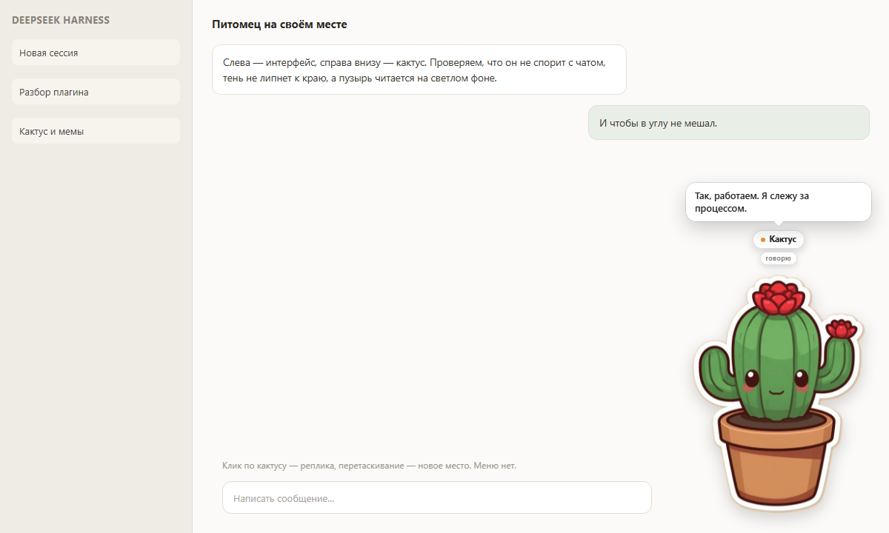
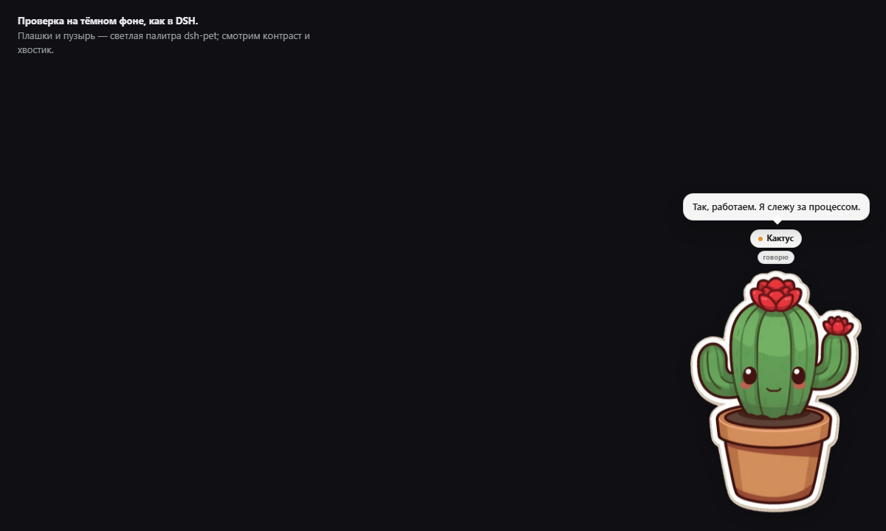
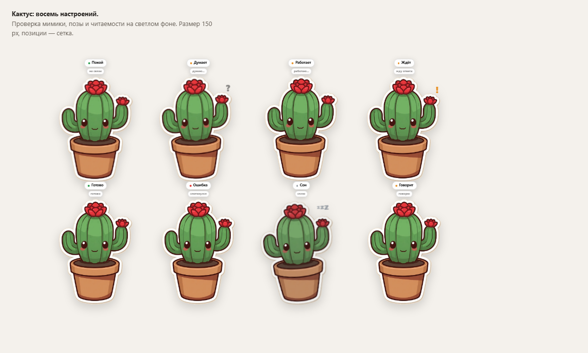

# 🌵 dsh-pet-cactus

[](https://www.npmjs.com/package/dsh-pet-cactus)
[](LICENSE)
[](package.json)
[](package.json)

[Русский](README.md) · [English](README.en.md)

People used to keep a cactus next to the monitor — supposedly it absorbed radiation.
The radiation is long gone. The cactus habit stayed.

So we put the cactus *inside* the monitor. It no longer absorbs radiation; it absorbs
`tool/call` events, `turn/start`, and your last configuration mistake.

A pet for **DeepSeek Harness**: lives in the corner of the Web-GUI, gets dragged
around, reacts to whatever the agent is doing, and talks Russian.
No watering required — it's a plugin.

The only pet that survives Ctrl+W.

*About the radiation: it is a myth — a cactus shields nothing. It is just nice.*

**Author — Samugor.** MIT license: the author's name is baked into the bundle, the markup
and the license.



On a dark background — this is how it looks inside DSH itself:



Not another "CSS kitten": the plugin has a host half (settings, HTTP, subscription to
session events) and a browser half (rendering and animation). They talk to each other
through four routes and nothing else.

## What it does

- **Lives in the corner** — above the interface, never steals clicks, can be dragged
  anywhere and remembers where you left it.
- **Reacts to the agent** — while the model thinks, the cactus thinks; while a tool runs,
  it says "Knocking on the terminal"; when it finishes — "Done"; on an error — "Well…
  happens".
- **Talks** — 60+ hand-written lines grouped by mood, with an auto-scrolling bubble and
  without one. Your own phrases are added through the config.
- **Plates above its head** — name and status ("thinking…", "working…", "asleep") in the
  dsh-pet palette: a white card, `#1f1f1f` text, a neutral border and shadow, a state dot.
  The text is live and changes with the mood instead of being baked into an image.
- **No menus at all** — no context menu opens on click or right-click: clicking the cactus
  just makes it talk.
- **Falls asleep** when ignored; clicking it wakes the cactus up and gets a line.
- **Remembers** its size, corner and position between launches.
- **Shuts up** if asked: `speech: false`, `reactToAgent: false`.
- **No network.** Not a single outgoing request: only the local DSH.



## What it does not do

- does not call a model and does not read project files — only tool names;
- does not touch the internet (no telemetry, no TTS, no "balance");
- does not open a second desktop window — this is Web-GUI only;
- does not break the interface when something is unavailable: without the host the pet runs
  on local defaults, without React it simply does not render.

## Install

```sh
dsh plugin --profile desktop add dsh-pet-cactus
```

Then **fully restart DSH**: the host half is read when the app starts, and refreshing the
page will not pick it up. After the restart the cactus appears in the bottom-right corner.

Check that the host is alive:

```sh
curl http://127.0.0.1:<port>/dsh-pet-cactus/health
# {"ok":true,"name":"dsh-pet-cactus","version":"0.1.5","mood":"idle","configSource":"default"}
```

The port is the one DSH prints in its log on startup.

Rollback, manual install and development from a folder — see [docs/INSTALL.md](docs/INSTALL.md)
(Russian).

## Controls

| Action | What happens |
|---|---|
| Click the cactus | a line (and waking up, if it was asleep) |
| Right click | nothing: the system menu is suppressed, its own never opens |
| Drag | moving it; release and the position is saved |
| `Enter` / `Space` while focused | a line |
| Arrow keys while focused | move by 16 px |

## Settings

File: `%DSH_HOME%/dsh-pet-cactus/main-config.json` (usually `~/.dsh/...`).
Edit it by hand or through `PUT /dsh-pet-cactus/api/config` — applied immediately, no restart.

```json
{
  "name": "Кактус",
  "size": 240,
  "corner": "bottom-right",
  "marginX": 28,
  "marginY": 28,
  "opacity": 1,
  "speech": true,
  "speechIntervalMin": 12,
  "bubbleMs": 6500,
  "sleepAfterMin": 20,
  "reactToAgent": true,
  "reducedMotion": "auto",
  "phrases": []
}
```

Every key and its bounds are documented in [docs/CONFIG.md](docs/CONFIG.md) (Russian).
An invalid patch is rejected as a whole: the route answers `400` with the list of reasons
and the file stays untouched.

## Reactions to the agent

| DSH event | Mood | Example line |
|---|---|---|
| `turn/start` | thinking | «Думаю над задачей» — "Thinking it over" |
| `tool/call` | working | «Стучу по терминалу» — "Knocking on the terminal" |
| `approval/asked` | waiting | «Жду твоего решения» — "Waiting for your call" |
| `turn/end` → `completed` | success | «Готово» — "Done" |
| `turn/end` → `error` | error | «Ой. Не вышло» — "Oops. Didn't work" |
| `turn/end` → `blocked` | waiting | «Нужно твоё решение» — "Needs your call" |

Events from sub-agents and deep delegations are ignored: the user is waiting for the main
answer, not for a report from every helper. Reactions are switched with `reactToAgent`.

## HTTP

All routes sit under `/dsh-pet-cactus`, local only, no authorization: this is one user's
data on their own machine. Bodies are capped at 64 KB.

| Method | Path | Purpose |
|---|---|---|
| `GET` | `/health` | name, version, current mood |
| `GET` | `/api/state` | `{ mood, text, seq, updatedAt }` |
| `GET` | `/api/config` | config, its source, path to the file |
| `PUT` / `POST` | `/api/config` | partial config update |
| `POST` | `/api/say` | make it say `{ "text": "..." }` |

```sh
curl -X POST http://127.0.0.1:<port>/dsh-pet-cactus/api/say \
  -H 'content-type: application/json' \
  -d '{"text":"Привет, Серёга"}'
```

## How it is built

```
lib/index.js      host: routes, state, subscription to session/event
lib/config.js     defaults, validation, atomic write
lib/tool-lines.js reaction texts for tools
lib/client.js     browser: built from src/client/*.js (no bundler)
src/client/       geometry, phrases, DOM engine, ModuleLoader adapter
```

The client half is a plain script that calls `window.__ModuleLoader__.load` itself:
no imports, no bundler, no dependencies. React arrives through `require` in the module
factory. More in [docs/ARCHITECTURE.md](docs/ARCHITECTURE.md) (Russian).

## Development

```sh
npm run build     # build lib/client.js from src/client
npm test          # 54 tests: config, geometry, routes, adapter, parity
npm run preview   # preview/states.html and preview/live.html
python scripts/make-icon.py  # rebuild the plugin icon from assets/pet.webp
```

Tests run in a single process (`scripts/test.mjs`): `node --test` spawns child processes
and dies with `EPERM` inside the DSH sandbox.

Installing from a folder:

```sh
# in the profile's package.json: "dsh-pet-cactus": "link:D:/path/to/dsh-pet-cactus"
# then restart DSH
```

## Compatibility

Verified on DSH **0.2.2-rc.3**, Web-GUI, Windows 11, Node 26.
The plugin relies on public contracts (`webServer.register`, `ctx.on('session/event')`,
`ctx.slots`, `__ModuleLoader__`) and degrades when they are missing instead of crashing
the startup.

## License

MIT © Samugor. Code and artwork are original; no third-party assets.
