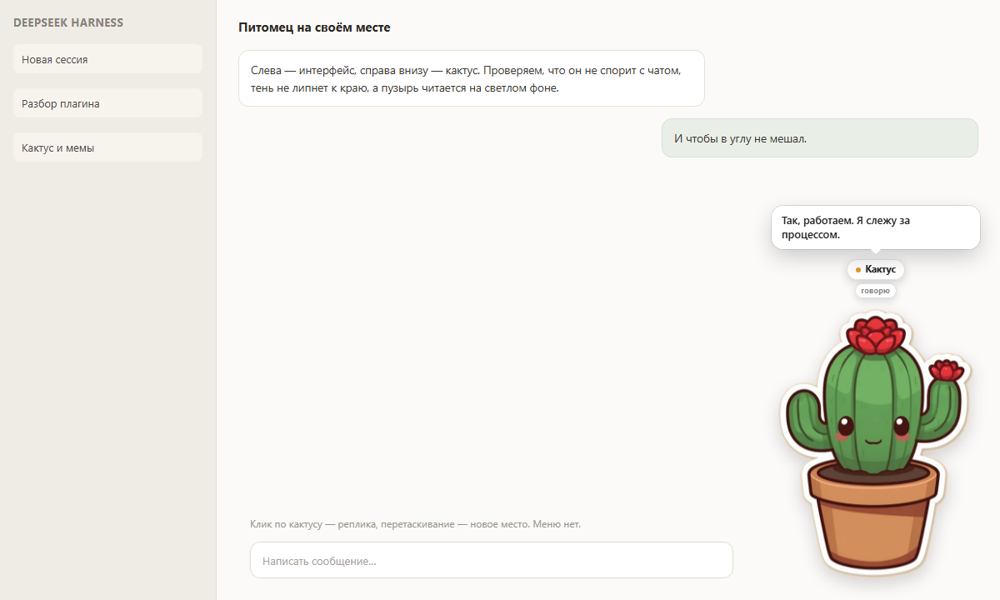
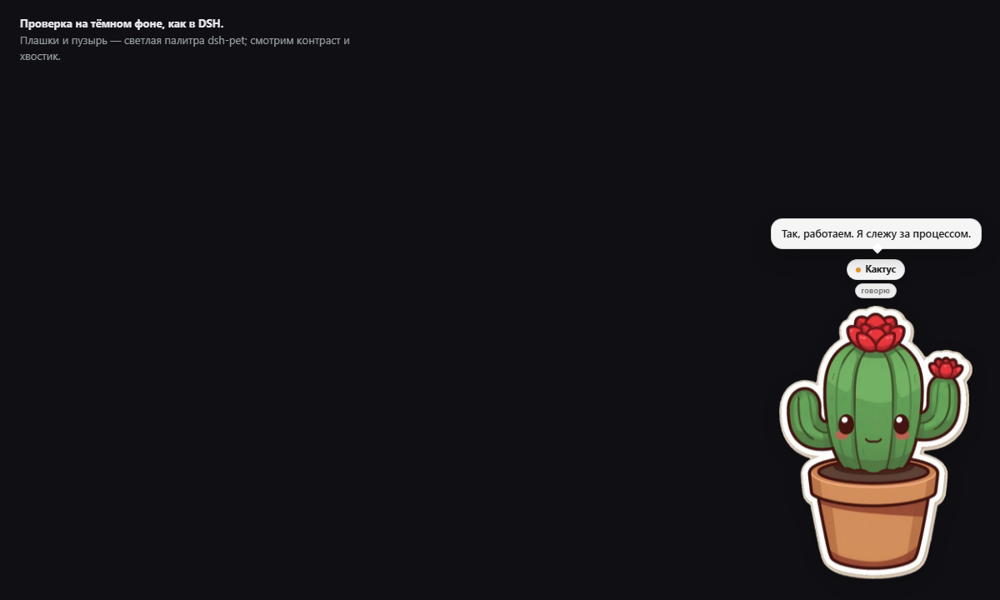
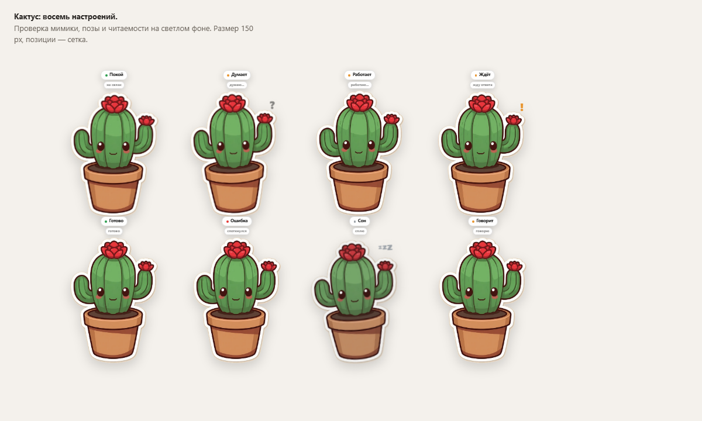

# 🌵 dsh-pet-cactus

[Русский](README.md) · [English](README.en.md)

Раньше кактус ставили рядом с монитором — «чтобы ловил излучение».
Излучение от мониторов давно кончилось. Кактус — нет.

Мы поставили его внутрь монитора. Теперь он ловит не излучение, а `tool/call`,
`turn/start` и твою последнюю ошибку в конфиге.

Питомец для **DeepSeek Harness**: живёт в углу Web-GUI, перетаскивается мышкой,
реагирует на работу агента и говорит по-русски. Поливать не надо — это плагин.

Единственный питомец, который переживает Ctrl+W.

*Про излучение — это, конечно, миф: кактус ничего не экранирует. Он просто милый.*

**Автор — Samugor.** Лицензия MIT: имя автора вшито в бандл, разметку и лицензию.



На тёмном фоне — так, как это видно в самом DSH:



Не очередной «котик на CSS»: у плагина есть host-половина (настройки, HTTP,
подписка на события сессий) и браузерная половина (рендер и анимации).
Между собой они общаются четырьмя маршрутами и ничем больше.

## Что умеет

- **Живёт в углу** — поверх интерфейса, не мешает кликам, перетаскивается в любое место
  и запоминает позицию.
- **Реагирует на агента** — пока модель думает, кактус думает; пока бежит инструмент —
  «Стучу по терминалу»; закончилось — «Готово»; ошибка — «Ну… бывает».
- **Говорит** — 60+ авторских реплик по настроениям, пузырь с автопрокруткой и без.
  Свои фразы добавляются в конфиг.
- **Плашки над головой** — имя и статус («думаю…», «работаю…», «сплю») в палитре
  dsh-pet: белая карточка, текст `#1f1f1f`, нейтральная рамка и тень, точка
  состояния. Текст живой и меняется вместе с настроением, а не вшит в картинку.
- **Никакого меню** — контекстное меню не открывается ни кликом, ни правой кнопкой:
  клик по кактусу просто говорит реплику.
- **Засыпает** без внимания: клик по кактусу будит и говорит.
- **Помнит** размер, угол и позицию между запусками.
- **Молчит**, если попросить: `speech: false`, `reactToAgent: false`.
- **Не требует сети**. Ни одного запроса наружу: только локальный DSH.



## Чего не делает

- не вызывает модель и не читает файлы проекта — только имена инструментов;
- не ходит в интернет (никакой телеметрии, TTS, «баланса»);
- не открывает второе окно поверх рабочего стола — это только Web-GUI;
- не ломает интерфейс, если что-то недоступно: без хоста питомец работает
  на локальных умолчаниях, без React — просто не рендерится.

## Установка

```sh
dsh plugin --profile desktop add dsh-pet-cactus
```

Затем **полностью перезапустить DSH**: host-половина читается при старте приложения,
обновление страницы её не подхватит. После перезапуска кактус появится в правом
нижнем углу.

Проверка, что хост жив:

```sh
curl http://127.0.0.1:<порт>/dsh-pet-cactus/health
# {"ok":true,"name":"dsh-pet-cactus","version":"0.1.5","mood":"idle","configSource":"default"}
```

Порт — тот, что DSH пишет в лог при запуске.

Подробности, откат и разработка из папки — в [docs/INSTALL.md](docs/INSTALL.md).

## Управление

| Действие | Что происходит |
|---|---|
| Клик по кактусу | реплика (и пробуждение, если спал) |
| Правый клик | ничего: системное меню подавлено, своё не открывается |
| Перетаскивание | перенос; отпустил — позиция сохранена |
| `Enter` / `Space` в фокусе | реплика |
| Стрелки в фокусе | сдвиг на 16 px |

## Настройки

Файл: `%DSH_HOME%/dsh-pet-cactus/main-config.json` (обычно `~/.dsh/...`).
Меняется вручную или через `PUT /dsh-pet-cactus/api/config` — сразу, без перезапуска.

```json
{
  "name": "Кактус",
  "size": 240,
  "corner": "bottom-right",
  "marginX": 28,
  "marginY": 28,
  "opacity": 1,
  "speech": true,
  "speechIntervalMin": 12,
  "bubbleMs": 6500,
  "sleepAfterMin": 20,
  "reactToAgent": true,
  "reducedMotion": "auto",
  "phrases": []
}
```

Полное описание каждого ключа и границ — в [docs/CONFIG.md](docs/CONFIG.md).
Невалидный патч не применяется целиком: маршрут отвечает `400` со списком причин,
файл остаётся прежним.

## Реакции на агента

| Событие DSH | Настроение | Пример реплики |
|---|---|---|
| `turn/start` | думает | «Думаю над задачей» |
| `tool/call` | работает | «Стучу по терминалу», «Роюсь в тексте» |
| `approval/asked` | ждёт | «Жду твоего решения» |
| `turn/end` → `completed` | готово | «Готово» |
| `turn/end` → `error` | ошибка | «Ой. Не вышло» |
| `turn/end` → `blocked` | ждёт | «Нужно твоё решение» |

События суб-агентов и глубоких делегаций игнорируются: пользователь ждёт основной
ответ, а не отчёт каждого помощника. Реакция включается и выключается ключом
`reactToAgent`.

## HTTP

Все маршруты под префиксом `/dsh-pet-cactus`, только локально, без авторизации:
это данные одного пользователя на его машине. Тела ограничены 64 КБ.

| Метод | Путь | Назначение |
|---|---|---|
| `GET` | `/health` | имя, версия, текущее настроение |
| `GET` | `/api/state` | `{ mood, text, seq, updatedAt }` |
| `GET` | `/api/config` | конфиг, источник, путь к файлу |
| `PUT` / `POST` | `/api/config` | частичное обновление конфига |
| `POST` | `/api/say` | заставить сказать `{ "text": "..." }` |

```sh
curl -X POST http://127.0.0.1:<порт>/dsh-pet-cactus/api/say \
  -H 'content-type: application/json' \
  -d '{"text":"Привет, Серёга"}'
```

## Как устроено

```
lib/index.js      host: маршруты, состояние, подписка на session/event
lib/config.js     умолчания, валидация, атомарная запись
lib/tool-lines.js тексты реакций на инструменты
lib/client.js     браузер: собран из src/client/*.js (без бандлера)
src/client/       геометрия, фразы, DOM-движок, адаптер ModuleLoader
```

Клиентская половина — обычный скрипт, который сам зовёт
`window.__ModuleLoader__.load`: ни импортов, ни сборщика, ни зависимостей.
React приходит через `require` в фабрике модуля. Подробнее —
[docs/ARCHITECTURE.md](docs/ARCHITECTURE.md).

## Разработка

```sh
npm run build     # собрать lib/client.js из src/client
npm test          # 54 теста: конфиг, геометрия, маршруты, адаптер, согласованность
npm run preview   # preview/states.html и preview/live.html
python scripts/make-icon.py  # пересобрать иконку плагина из assets/pet.webp
```

Тесты идут одним процессом (`scripts/test.mjs`): `node --test` порождает
дочерние процессы и в песочнице DSH падает с `EPERM`.

Локальная установка из папки:

```sh
# в package.json профиля: "dsh-pet-cactus": "link:D:/путь/к/dsh-pet-cactus"
# затем перезапуск DSH
```

## Совместимость

Проверено на DSH **0.2.2-rc.3**, Web-GUI, Windows 11, Node 26.
Плагин опирается на публичные контракты (`webServer.register`, `ctx.on('session/event')`,
`ctx.slots`, `__ModuleLoader__`) и деградирует, если их нет, а не валит старт.

## Лицензия

MIT © Samugor. Код и рисунок — авторские, сторонних ассетов нет.
